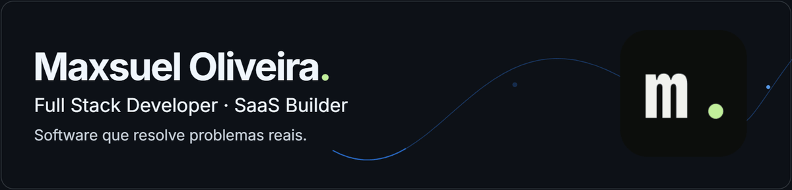
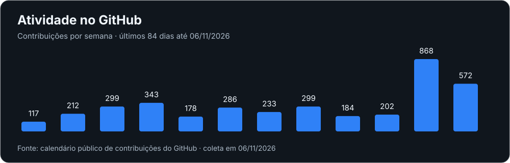
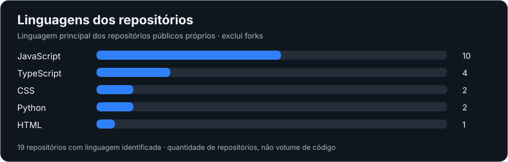

  <picture>
    <source type="image/gif" srcset="assets/banner.gif" />
    
  </picture>

## Projetos em produção

<a href="https://zapedesk.com.br">
  <picture>
    <source type="image/gif" srcset="assets/zapedesk.gif" />
    
  </picture>
</a>

<a href="https://carbonatochat.com.br">
  <picture>
    <source type="image/gif" srcset="assets/carbonatochat.gif" />
    
  </picture>
</a>

<a href="https://ligaaierp.lvempreendimentosbahia.com.br/">
  <picture>
    <source type="image/gif" srcset="assets/ligaai-erp.gif" />
    
  </picture>
</a>

## Código em movimento

Dados públicos coletados em 06/11/2026. O gráfico de linguagens conta repositórios por linguagem principal; não representa volume de código. As animações dos projetos são demonstrações gravadas dos sites.

## Stack principal

React · TypeScript · Node.js · Python · PostgreSQL · Docker

[Mais sobre meu trabalho ↗](https://max.webart3.com) · [LinkedIn ↗](https://www.linkedin.com/in/maxsueloliveiradev/)
